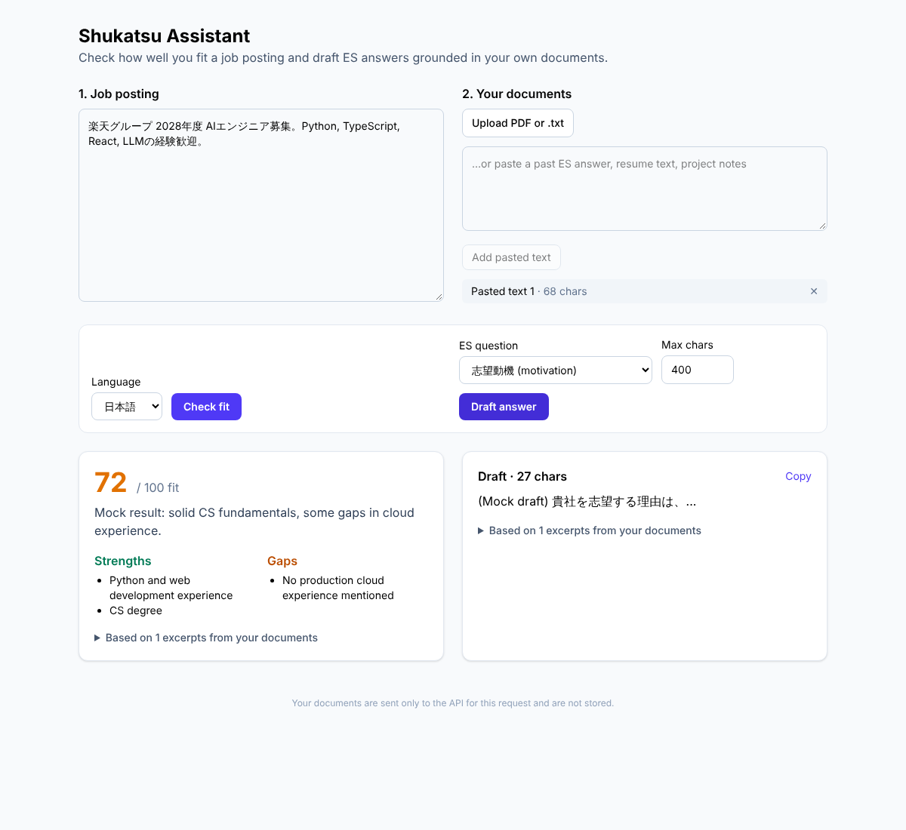
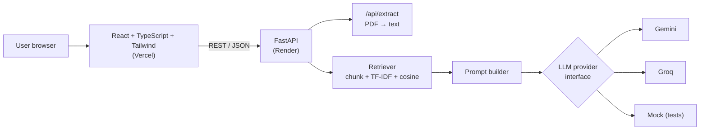
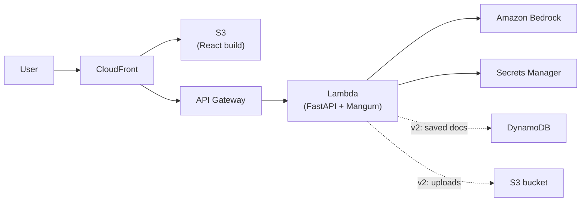

# Shukatsu Assistant 就活アシスタント

Paste a job posting, add your resume or past entry sheet (ES) answers, and get:

- **A fit score** (0–100) with strengths and gaps
- **An ES draft** (志望動機 or ガクチカ) in Japanese or English

Answers are **grounded in your own documents** with retrieval-augmented generation (RAG), so the model writes about experience you actually have and you can see which excerpts it used.

**Live demo:** _coming soon_ · **API docs:** `/docs` on the API server



## Architecture



**Request flow for `/api/fit` and `/api/draft`:**

1. The front end sends the job posting and the user's documents as JSON.
2. The retriever splits documents into ~400‑character overlapping chunks and ranks them against the job posting with character n‑gram TF‑IDF (works for Japanese, which has no spaces, and English).
3. The top 5 chunks go into the prompt as numbered excerpts. The prompt tells the model to use only those facts.
4. The LLM returns JSON, which FastAPI validates with Pydantic before sending it back with the excerpts as evidence.

The API is **stateless**: nothing is stored, which keeps it simple, private, and easy to run on serverless platforms.

## Tech stack

| Layer | Tech | Why |
| --- | --- | --- |
| Front end | React 19, TypeScript, Tailwind CSS, Vite | Typed components, fast dev server |
| API | Python, FastAPI, Pydantic | Request validation and auto‑generated OpenAPI docs |
| Retrieval | Pure‑Python TF‑IDF over character n‑grams | No paid embedding API, language‑agnostic |
| LLM | Gemini or Groq (free tiers), behind one interface | Swappable provider, mock for tests |
| CI | GitHub Actions | Runs pytest and the front‑end build on every push |
| Hosting | Vercel (front end), Render (API) | Free tiers, no credit card |

## Run locally

```bash
# API
cd backend
python -m venv .venv && source .venv/bin/activate
pip install -r requirements-dev.txt
cp .env.example .env          # LLM_PROVIDER=mock works with no key
uvicorn app.main:app --reload # http://localhost:8000/docs
pytest

# Front end (new terminal)
cd frontend
npm install
npm run dev                   # http://localhost:5173
```

To use a real model, get a free key from [Google AI Studio](https://aistudio.google.com/) or [Groq](https://console.groq.com/), then set `LLM_PROVIDER=gemini` and `GEMINI_API_KEY` (or the Groq equivalents) in `backend/.env`.

## Deploy (free)

- **API on Render:** New → Blueprint → pick this repo. `render.yaml` configures it. Set `GEMINI_API_KEY` and `CORS_ORIGINS` in the dashboard. Free instances sleep when idle, so the first request can take ~1 minute.
- **Front end on Vercel:** import the repo, set the root directory to `frontend`, and set `VITE_API_URL` to the Render URL.

## Deploying on AWS

The code is cloud‑portable: config comes from environment variables, and the API holds no state. On AWS it would look like this:



| Piece | Here | On AWS |
| --- | --- | --- |
| Static front end | Vercel | S3 + CloudFront |
| API | Render (uvicorn) | Lambda via `app/lambda_handler.py` ([Mangum](https://github.com/jordaneremieff/mangum)) behind API Gateway |
| LLM | Gemini / Groq | Amazon Bedrock: add one `BedrockLLM` class in `app/llm.py` |
| Secrets | Render env vars | Secrets Manager or SSM Parameter Store |
| Storage (planned) | none | DynamoDB for saved documents and history, S3 for uploaded files |
| Monitoring | Render logs | CloudWatch Logs and metrics |

Lambda fits this API well: requests are short and stateless, traffic is spiky, and you pay per request instead of for an always‑on server.

## Roadmap

- [x] v0.1: fit score, ES drafts, PDF upload, TF‑IDF retrieval, mock provider, CI
- [ ] Live demo deployed on Vercel + Render
- [ ] Embedding‑based retrieval (vector search) and a comparison with TF‑IDF
- [ ] Save documents in the browser so you don't re‑upload
- [ ] Rate limiting to protect the free LLM quota
- [ ] More ES questions (自己PR, 挫折経験)
